<div align="center">

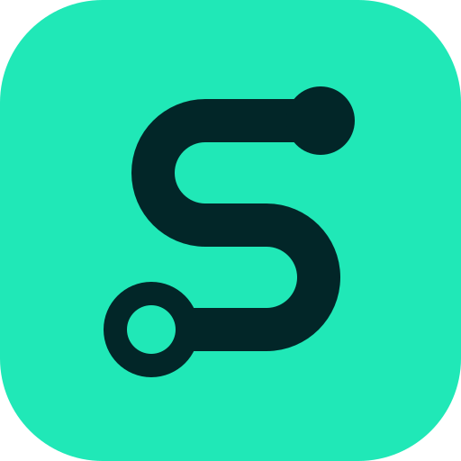

# Shipline

**Lleva tus proyectos a buen puerto.**

Anota cada proyecto con su idea y su color, y llévalo por cuatro estaciones hasta publicarlo:<br />
idea, en desarrollo, terminado y publicado. Funciona en el celular y en la PC, y se instala como app.

[**shipline.acmsy.com**](https://shipline.acmsy.com)

<br />


<br />

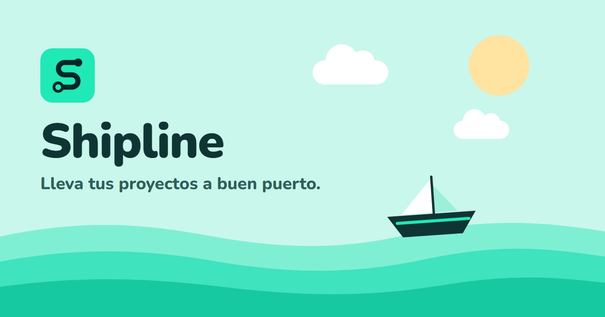

</div>

<br />

## Qué hace

| | |
|---|---|
| **Cuatro estaciones** | Cada proyecto está en idea, en desarrollo, terminado o publicado. La lista los agrupa por estación y la bienvenida te dice cuántos llevas en desarrollo y cuántos publicados. |
| **Mover desde la lista** | Al pasar el mouse por una fila aparecen el sitio y el repositorio (si los tiene) y «Mover», un menú con las cuatro estaciones. Cada cambio se deshace desde el aviso, y al llegar a publicado lo anuncia: «Confetti llegó a Publicado». |
| **La ficha del proyecto** | Nombre, idea, estación, color, sitio publicado y repositorio, en un panel lateral que en el celular sube desde abajo. |
| **Color e insignia** | Siete colores o uno propio. La insignia lleva la inicial y elige tinta o blanco según el contraste. |
| **Buscar y filtrar** | Búsqueda por nombre o idea, y filtro por estación con el conteo de cada una. Atajos: «/» busca y «N» crea un proyecto. |
| **Eliminar sin sustos** | El botón se mantiene presionado mientras la barra se llena; si lo sueltas antes no pasa nada, y el aviso deja deshacerlo. |
| **Tu cuenta** | Entra con Google o con correo y contraseña. La contraseña se recupera con un enlace por correo. |
| **Oscuro por defecto** | El tema claro es opcional y se recuerda en una cookie. |

<br />

## Capturas

<table>
  <tr>
    <td width="50%">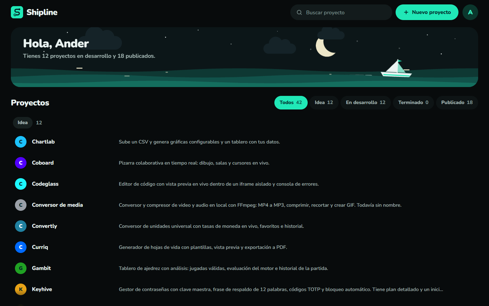</td>
    <td width="50%">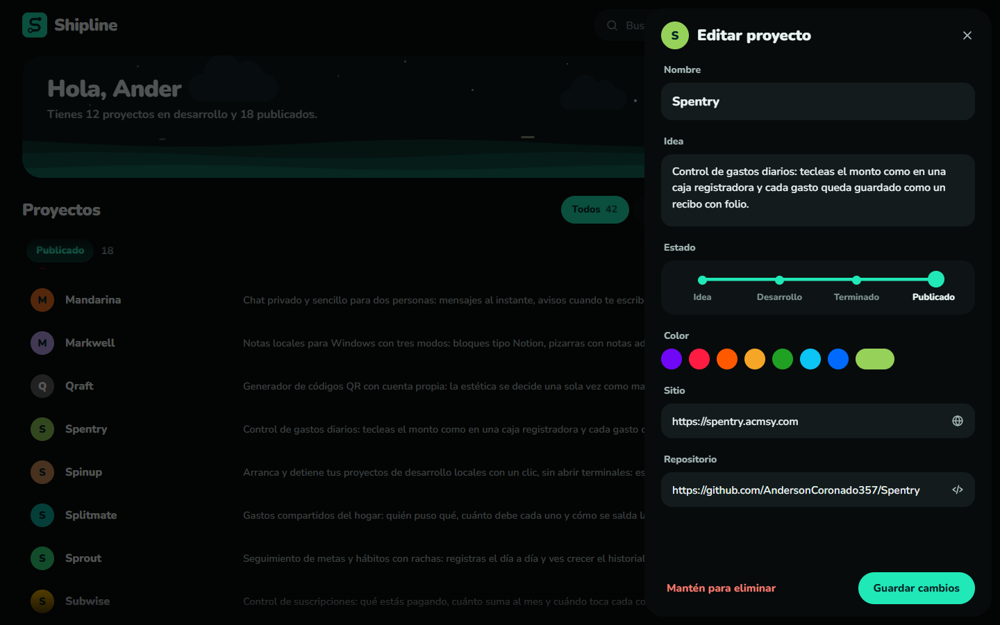</td>
  </tr>
  <tr>
    <td align="center"><sub><b>Proyectos</b> · agrupados por estación, con el barco en la bienvenida</sub></td>
    <td align="center"><sub><b>Editar</b> · nombre, idea, estación, color, sitio y repositorio</sub></td>
  </tr>
  <tr>
    <td width="50%">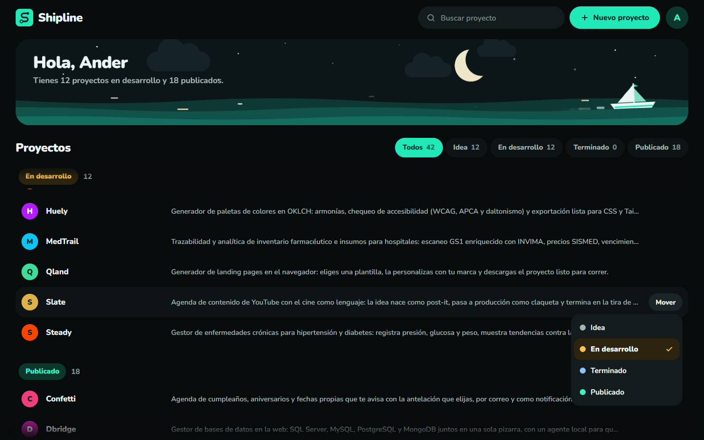</td>
    <td width="50%">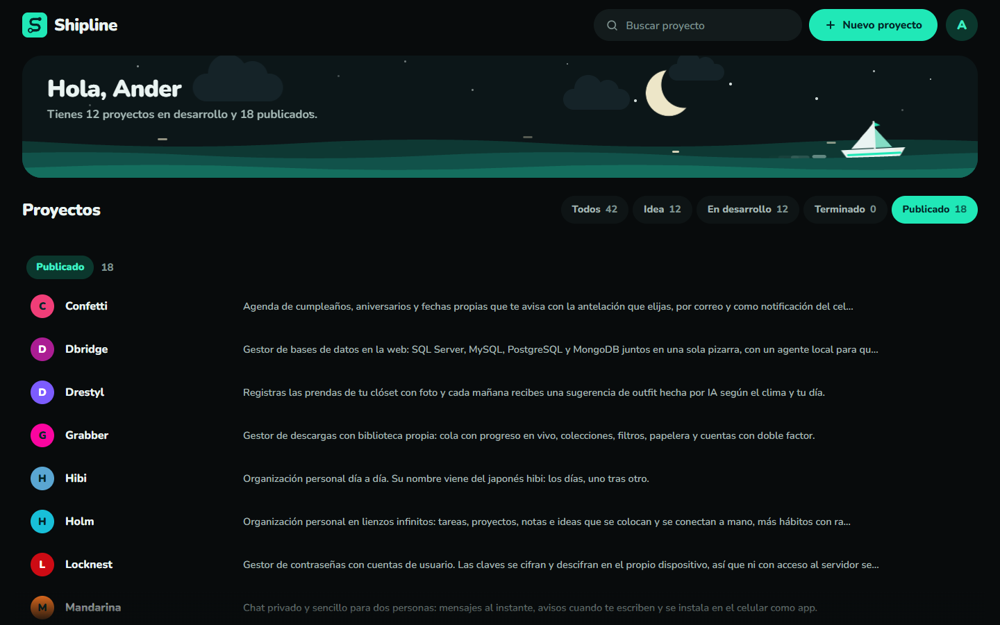</td>
  </tr>
  <tr>
    <td align="center"><sub><b>Mover</b> · las cuatro estaciones salen de la misma fila</sub></td>
    <td align="center"><sub><b>Publicados</b> · el filtro se desliza hasta la estación elegida</sub></td>
  </tr>
  <tr>
    <td width="50%">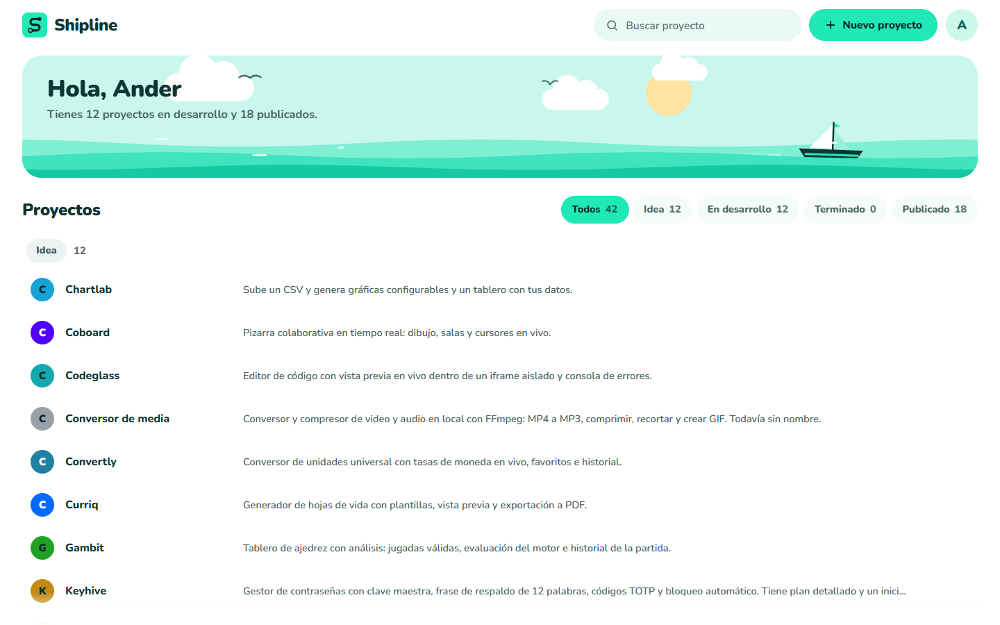</td>
    <td width="50%">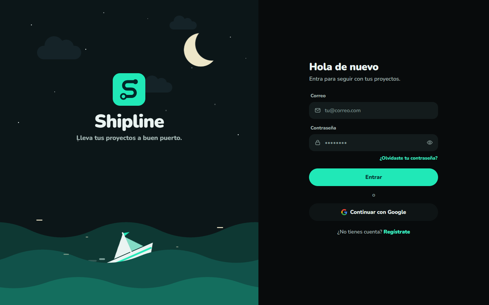</td>
  </tr>
  <tr>
    <td align="center"><sub><b>Tema claro</b> · de día salen el sol y las gaviotas</sub></td>
    <td align="center"><sub><b>Entrar</b> · el barco navega en altamar</sub></td>
  </tr>
  <tr>
    <td width="50%">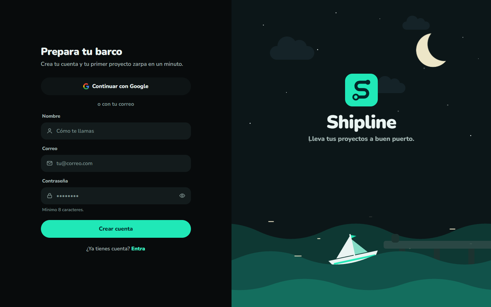</td>
    <td width="50%">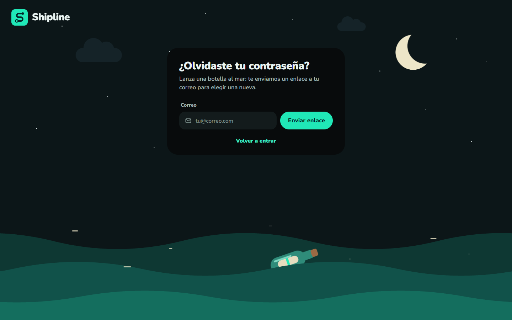</td>
  </tr>
  <tr>
    <td align="center"><sub><b>Crear cuenta</b> · el mar cambia de lado y el barco espera en el muelle</sub></td>
    <td align="center"><sub><b>Recuperar</b> · una botella con el mensaje flota a la deriva</sub></td>
  </tr>
</table>

<div align="center">
  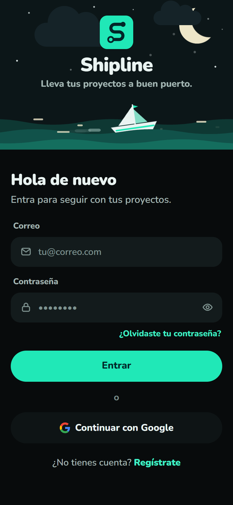
  &nbsp;
  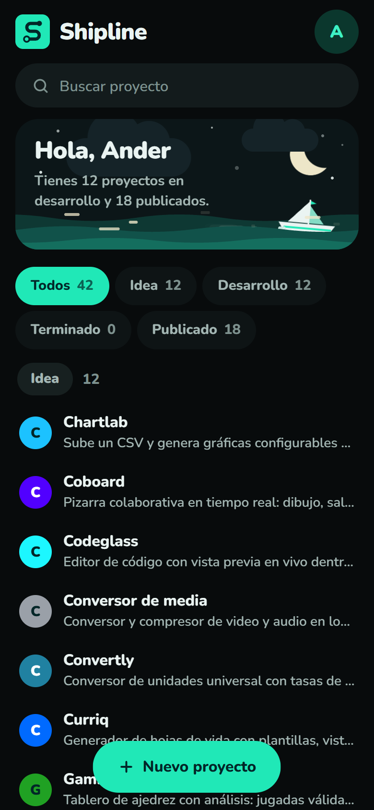
  &nbsp;
  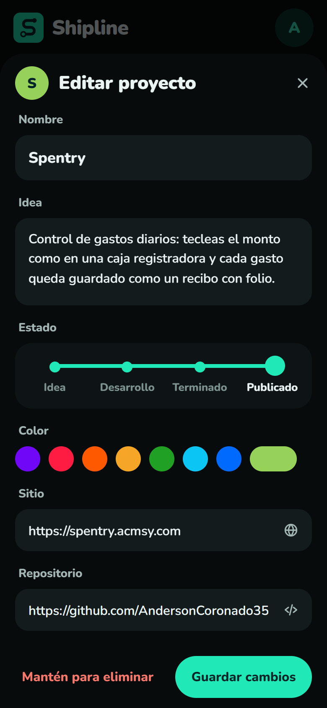
  <br />
  <sub>En el celular todo pasa a una columna y «Nuevo proyecto» queda a mano, abajo.</sub>
</div>

<br />

## Diseño

Shipline gira alrededor de una idea: **cada proyecto es un barco que zarpa hacia publicado**. El mar
decide el movimiento, no al revés.

- **El barco navega de verdad.** Su altura y su inclinación salen de la misma curva que dibuja la ola, así que sube, baja y cabecea con ella, y deja una estela de espuma. Nada flota en un punto fijo.
- **Cada pantalla de cuenta tiene su escena y su distribución.** Entrar: el mar a un lado y el barco en altamar. Crear cuenta: el formulario cambia de lado y el barco espera amarrado al muelle. Recuperar: el mar a toda la pantalla y una botella con un mensaje.
- **La marea cambia de pantalla.** Entre entrar, crear cuenta y recuperar no se recarga la página: sube la marea en tres capas, el barco surfea la cresta (o la botella cae y salpica), la pantalla cambia debajo del agua y la marea baja descubriéndola.
- **Noche y día.** De noche, luna creciente, estrellas que titilan y alguna estrella fugaz; de día, sol, nubes y gaviotas.
- **La lista se reordena sola** al mover un proyecto, y los conteos ruedan hasta su nuevo valor.
- **Oscuro casi negro** (`#080B0C`) con un solo acento aguamarina (`#20E8B7`).
- **Plano y limpio.** Sin bordes, sin sombras y sin anillos: la jerarquía sale del fondo, del espacio y de la tipografía.
- **Hover sin mover nada.** Al pasar el mouse solo cambia el color; nada crece ni se desplaza.
- **Todo a pantalla completa**, sin scroll general en la PC: la lista hace scroll por dentro, con un desvanecido que avisa que hay más.
- **Tipografía:** Nunito, redondeada, para títulos y texto.

<br />

## Stack

| Capa | Tecnología |
|---|---|
| Servidor | **Node 22** con **Express 4** |
| Interfaz | HTML armado en el servidor, CSS y **JavaScript** sin frameworks ni compilación |
| Animación | CSS, SVG, Web Animations API y View Transitions |
| Datos | **PostgreSQL** con `pg`; las tablas se crean solas al primer uso |
| Sesión | Cookie firmada con HMAC, CSRF de doble envío y contraseñas con `scrypt`; Google OAuth |
| Correo | Resend, para recuperar la contraseña |
| PWA | Manifiesto y service worker propios |
| Despliegue | Docker sobre acmsy, detrás de Cloudflare |

<br />

## Estructura

```
Shipline/
  server.js          Portada, app, API /api/proyectos, archivos de SEO y cabeceras de caché
  views.js           HTML de la portada, las pantallas de cuenta y la app, con sus metadatos
  proyectos.js       Tabla de proyectos y validación
  shared/
    auth/            Sesión, Google, registro y recuperación de contraseña
    mailer/          Envío de correos con Resend
  plantillas/        robots.txt, sitemap.xml, llms.txt, manifiesto y sw.js
  public/
    app.css          Tokens, escena, pantallas de cuenta y app
    app.js           Lista, filtros, menú Mover, panel, avisos y tema
    escena.js        El barco y la botella sobre la ola
    marea.js         La marea entre entrar, crear cuenta y recuperar
    icons/           Logo e iconos de la app
    og.png           Imagen para compartir
  scripts/
    sembrar.js       Carga los proyectos iniciales en una cuenta
    render/          HTML de los iconos y de og.png
  docs/capturas/     Las capturas de este README
```

<br />

## Cómo correr en local

Necesitas **Node 22+** y **PostgreSQL**.

```bash
npm install
```

Copia `.env.example` como `.env` y completa `DATABASE_URL` y `SESSION_SECRET`. Luego:

```bash
npm run dev
```

Abre <http://localhost:3000> y crea una cuenta.

Opcional: cargar los proyectos iniciales en una cuenta. Si no existe, se crea sin contraseña y se entra
con Google con ese correo o eligiendo una desde «¿Olvidaste tu contraseña?».

```bash
npm run sembrar -- tu@correo.com
```

<br />

## Variables de entorno

| Variable | Para qué |
|---|---|
| `DATABASE_URL` | Conexión a PostgreSQL |
| `SESSION_SECRET` | Firma de la cookie de sesión: una cadena larga y aleatoria |
| `APP_URL` | URL pública de la app, para los enlaces del correo y Google |
| `PORT` | Puerto del servidor (3000 por defecto) |
| `GOOGLE_CLIENT_ID` · `GOOGLE_CLIENT_SECRET` | Entrar con Google (opcional) |
| `OAUTH_RELAY` | Dirección de retorno compartida de Google en producción (opcional) |
| `RESEND_API_KEY` · `MAIL_FROM` · `MAIL_FROM_NAME` | Correo de recuperación por Resend |

El `.env` nunca se sube al repositorio.

<br />

## Scripts

| Comando | Qué hace |
|---|---|
| `npm start` | Servidor en el puerto de `PORT` |
| `npm run dev` | Igual, pero se reinicia al guardar |
| `npm run sembrar -- correo` | Carga los proyectos iniciales en esa cuenta, sin duplicar los que ya estén |

<br />

## PWA, SEO y despliegue

- **Instalable** en Android, iOS y PC. El icono maskable va a sangre sobre el mismo fondo oscuro del manifiesto, así la pantalla de inicio muestra solo el logo.
- **`sw.js` y el manifiesto nunca se cachean**, para que cada despliegue llegue de inmediato a las apps instaladas.
- **Vista previa al compartir** con Open Graph y tarjeta grande de X; **datos estructurados** (`WebSite` y `WebApplication`), `robots.txt`, `sitemap.xml` y `llms.txt` para buscadores e IAs.
- **Despliegue:** la imagen de Docker instala solo las dependencias de producción y sirve la app en el puerto 3000.

```bash
docker build -t shipline .
docker run -p 3000:3000 --env-file .env shipline
```

<br />

<div align="center">
  
  <br />
  <sub>Hecho por <b>Ander</b></sub>
</div>
